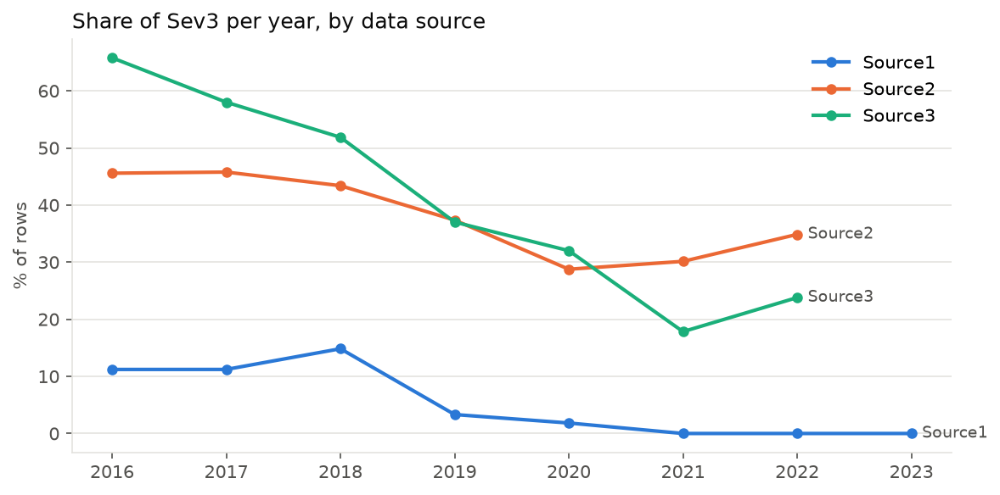

# California Traffic Accidents: Predicting Severity

When an accident is reported, how badly will it block the road? I tried to predict that for about
1.7 million accidents in California from 2016 to 2023, using the public
[US Accidents](https://www.kaggle.com/datasets/sobhanmoosavi/us-accidents) dataset.

"Severity" in this dataset is about traffic, not injuries: it says how much the accident slowed
everyone down. Most accidents are minor, and the worst ones are less than 1% of the data, which makes
them hard to catch.

## What I found

My best model gets a macro-F1 of **0.74** on accidents from the years it learned from. 
But on newer accidents, from 2022 and 2023, it drops to **0.59** and misses almost every one of the
most serious accidents (it caught 1 out of 3,362).

 The severity labels come from several data providers, and they don't label
accidents the same way. One provider calls about 2% of its accidents "Severity 3", another calls
about 40% of them that. They also change their habits over the years. So a big part of what the model
learns is simply *who reported the accident*, not what happened on the road. When the providers
changed their habits in 2022, the model had no way to know.



*One provider stopped using Severity 3 almost entirely after 2020, while the other two kept using it
for roughly 20–35% of their accidents.*

So the model is useful for the period it knows, but I wouldn't trust it to predict the future without
first checking how the data is being labeled.

## The models

I compared a few models and gave each of them a fair chance: the same data, the same preparation and
the same amount of tuning.

| Model | macro-F1 |
|---|---|
| Always guess the most common class | 0.30 |
| Logistic regression | 0.55 |
| Neural network | 0.62 |
| Random Forest | 0.72 |
| **LightGBM** | **0.73** |

(The first two were measured on a 10% sample of the training data, the rest on all of it.)

LightGBM and Random Forest were close, but LightGBM came out ahead in every round of
cross-validation, so I kept it (to be fair, on the full data I checked three LightGBM settings and only
the best one for the other models). Random Forest is a reasonable alternative if catching the worst accidents matters more than
avoiding false alarms.

The things the model relies on most are, in order: the data provider, the type of road (a highway or a
local street), wind speed, location, the month and the time of day.

## This is version 2

This project has a first version, saved under the tag
[`v1-original`](https://github.com/MiaByte-ctrl/california-accidents-ml/tree/v1-original). When I came
back to it, I realised its results looked better than they really were, so I rebuilt it:

- In the first version I had looked at the test results while choosing the model. That's a bit like
  seeing the exam answers before the exam. Now the test data is only used once, at the very end.
- The same accident was often recorded several times, and copies ended up in both the training and the
  test data. Now all copies of an accident stay together.
- I ignored the fact that labels depend on the provider and the year. Now I track it and test the
  model separately on later years.
- The comparison between models wasn't fair, and I used a score that can be inflated by simply guessing
  rare classes more often. Both are fixed.

The old numbers can't be compared with the new ones, because of these problems.

I rebuilt this version with the help of an AI coding assistant (Claude Code): I set the methodology
rules and made the key decisions, while the assistant wrote most of the code and ran the experiments,
which I then reviewed.

## If you want the details

The notebooks walk through everything step by step:

1. `01_data_and_split`: preparing the data and splitting it into training and test sets
2. `02_model_comparison`: comparing the models
3. `03_final_model`: training the final model and testing it
4. `04_shap`: what the model pays attention to

All the code lives in `src/`, and `tests/` has automatic checks that the test data never leaks into
training.

## How to run it

You need Python 3.11 or newer (the project was tested on 3.14).

```bash
git clone https://github.com/MiaByte-ctrl/california-accidents-ml
cd california-accidents-ml
pip install -r requirements.txt
```

Download `US_Accidents_March23.csv` from
[Kaggle](https://www.kaggle.com/datasets/sobhanmoosavi/us-accidents), put it in `data/raw/`, and run
the notebooks in order (`py -m jupyter notebook`).

Notebooks 02 and 03 show saved results by default. To recalculate everything, set `RECOMPUTE = True`
at the top (it takes about two hours). The trained model is included (`models/lightgbm_final.joblib`), so
notebook 04 works without retraining. On Windows with a GPU, install `torch` from the
[PyTorch website](https://pytorch.org/get-started/locally/) to get the GPU version.

To run the checks: `python -m pytest tests`.
